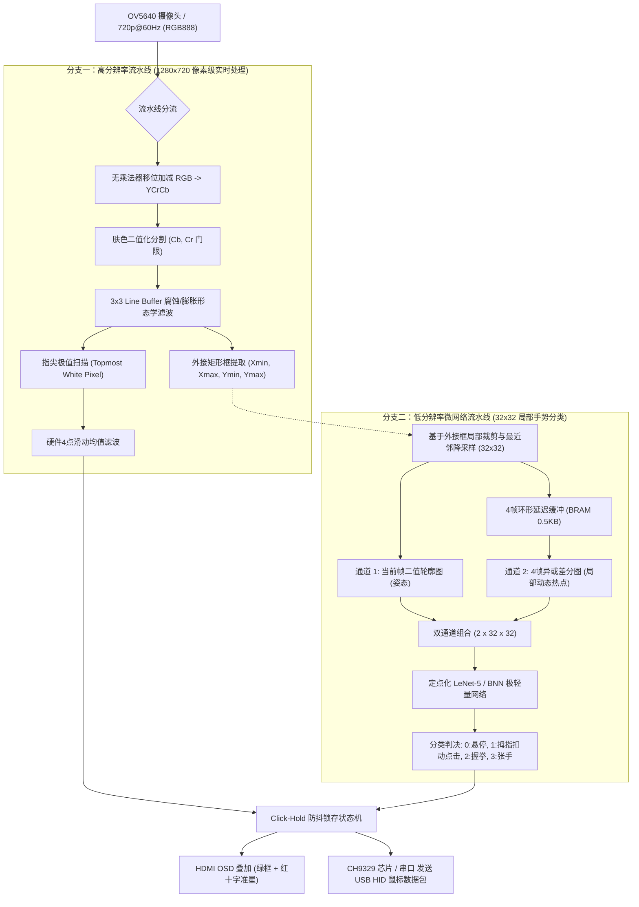

# 01. 系统整体架构与硬件流水线设计 (System Architecture & Hardware Pipeline)

> **目标平台**：紫光同创 盘古 200Pro (PanGo Logos-2 PG2L200H / 纯逻辑 FPGA，无硬核 ARM / NPU)  
> **核心任务**：实时食指指尖坐标连续追踪（虚拟鼠标） + 大拇指扣动微手势识别（左键点击） + 点击瞬间防抖锁存

---

## 一、 核心架构思想：异构双流协同并行流水线 (Heterogeneous Dual-Stream)

在纯逻辑 FPGA 上部署人机交互系统，最大的难点在于**全图运行高维深度学习网络的显存带宽与算力瓶颈**。如果对 $1280 \times 720$ 的原图直接跑 CNN，即便是最轻量的 MobileNet，也需要数十 GMACs 的算力，这在 200K 纯逻辑芯片上是无法实时跑在 60fps 的。

因此，本项目采用**“传统形态学视觉抓高精度坐标 + 微型神经网络识别细微手势”**的双流架构：

---

## 二、 关键模块功能解析与时序设计

### 1. 分支一：全分辨率形态学坐标流水线
* **RGB 转 YCrCb**：
  * 放弃传统浮点乘法器，采用移位与加法树（Shift-and-Add）实现。
  * 仅用 3 级流水寄存器，满足 74.25MHz（720p@60Hz）的建立保持时间要求，**DSP/APM 资源消耗严格为 0**。
* **肤色二值化与 $3 \times 3$ 形态学滤波**：
  * 利用紫光同创片内 DRM（Distributed RAM / Block RAM）构建 2 行 Line Buffer。
  * 滑动窗口生成 $3 \times 3$ 邻域矩阵。膨胀（Dilation）消除指骨间隙，腐蚀（Erosion）去除背景椒盐噪点。
* **极值指尖扫描与硬件均值滤波**：
  * 视频光栅扫描方向为自上而下（$Y: 0 \to 719$）。在帧有效期间，遇到的前若干个连续白色像素点必然是手部几何结构的最高点（即伸出的食指指尖）。
  * 硬件 4 点滑动均值滤波（Shift Register + 移位除以 4）直接滤除手部微颤，输出丝滑坐标。

### 2. 分支二：$32 \times 32$ 双通道特征强化与轻量分类
* **双通道输入机制（Two-Channel Input）**：
  * **静态通道（Channel 1）**：当前帧手掌 $32 \times 32$ 二值轮廓图，提供静态手势姿态（判断是握拳、张掌还是伸食指）。
  * **动态通道（Channel 2）**：当前帧与前第 4 帧的异或差分图（$I_t \oplus I_{t-4}$）。当食指保持不动、仅大拇指向掌心扣动时，大拇指轨迹在通道 2 呈现明显白色高亮亮斑，而食指全黑！微网络对“大拇指扣动”这类细微动作（Micro-Gesture）的分类灵敏度达到极值。
* **片内存储代价**：
  * $32 \times 32$ 的 1-bit 图像仅占 1024 bits。
  * 4 帧环形延迟缓冲仅需 $4 \times 1024 = 4096 \text{ bits} = 0.5 \text{ KB}$，消耗不到半个 9Kb DRM 块。

### 3. Click-Hold 坐标防抖锁存状态机 (Anti-Jitter Mechanism)
* **工程痛点**：在用手势控制鼠标时，人手做“大拇指扣向掌心”或“食指弯曲点击”的微秒瞬间，由于手掌肌腱连带运动，伸直的食指指尖必定会产生 **5~15 个像素的物理剧烈抖动**。这会导致虚拟鼠标在点击瞬间产生“拖拽/脱靶”误操作。
* **锁存机制**：
  * 状态机在检测到网络输出从 `HOVER`（悬停）向 `CLICK`（点击）跳变的瞬态时刻，**强制冻结光标坐标 $(X_{cursor}, Y_{cursor})$**，并开启 100ms 的硬锁存计数器。
  * 在锁存期间，对外输出恒定坐标并置位鼠标左键按下信号 `mouse_btn_left = 1`。
  * 待点击手势释放并经过 60ms 的释放消抖（Cooldown）后，平滑恢复连续追踪。

---

## 三、 紫光同创 PG2L200H 资源预算表 (Resource Budget)

| 硬件资源类型 | PG2L200H 芯片总量 | 本项目预计占用量 | 占用百分比 | 设计裕量评价 |
| :--- | :--- | :--- | :--- | :--- |
| **LUT5 (查找表)** | 196,800 | 约 18,500 | **9.4%** | 极其充裕，布线拥塞度极低 |
| **Flip-Flops (寄存器)**| 246,000 | 约 14,200 | **5.8%** | 充裕 |
| **DRM (Block RAM 18K)**| 840 | 18 | **2.1%** | 绝大部分 BRAM 可留给多帧图像缓存或扩充模型 |
| **APM (DSP 乘法器单元)**| 360 | 4 ~ 16 (若用 INT8 LeNet) / 0 (若用 BNN) | **1.1% ~ 4.4%** | 几乎零消耗 |
| **最高工作时钟频率** | 200+ MHz | 像素钟 74.25MHz / 逻辑钟 100MHz | 轻松满足建立保持时间收敛 |
